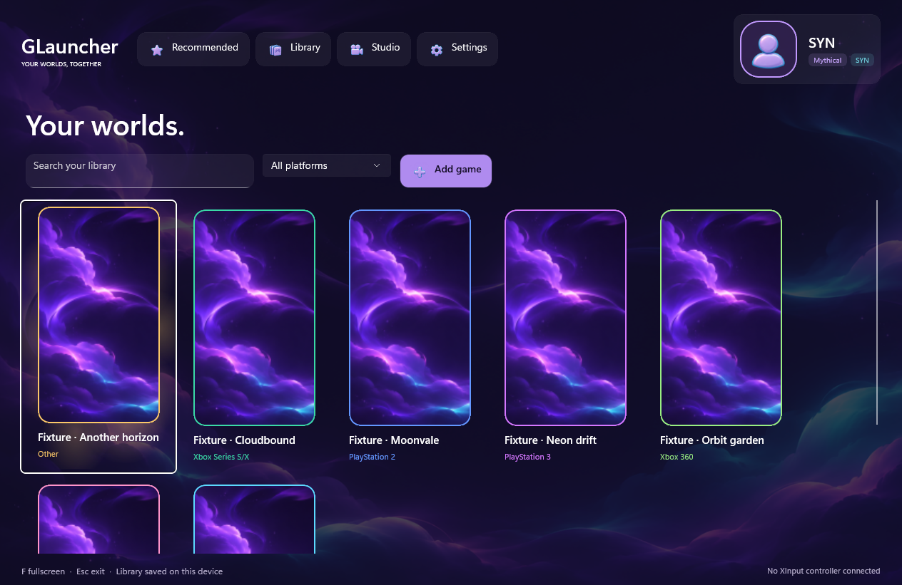
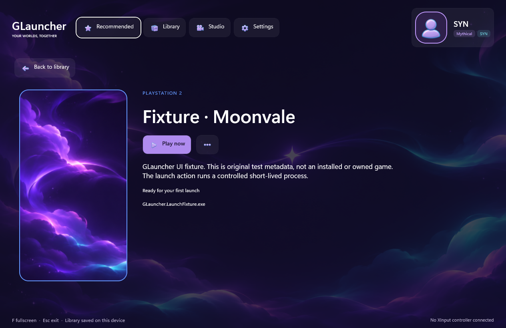

# GLauncher 0.1.0-alpha.1 validation

Compiled source: **177aa6197b1f9ba5e6c1196165b03ff5a1d399f6**, branch `codex/2-first-alpha`, [draft PR #6](https://github.com/lostfaithxenia/GLauncher/pull/6). Dependent on Claude's unchanged revision-2 Core at 5deb77210a608efcaa788d09ef88dfc902f3726b, [draft PR #5](https://github.com/lostfaithxenia/GLauncher/pull/5). Neither PR has been merged by an assistant.

## Delivered behavior

Portable Windows x64 app: silent opening video, owned recommendations, local EXE library with search/platform filter, 9:16 covers, platform-coloured compositor aura, full game pages and edit menu, atomic SQLite saves, local profile/picture/roles, light/dark appearance, glow/motion controls and PNG/JPG/MP4 backgrounds. Ordinary launcher input is foreground-gated. The session service uses caller IDs, independent replaying observers, verified native membership and conservative partial termination. Launcher exit leaves games running.

Normal libraries start empty. Test titles/artwork are explicitly labelled and remain in isolated fixture data directories, outside the portable folder. No actual user library/profile was published.

## Build, tests and packaging

Local Windows x64 SDK 10.0.403 / runtime 10.0.14:

```powershell
dotnet build -c Release -m:1 --disable-build-servers
dotnet test -c Release -m:1 --disable-build-servers --no-build --logger "trx;LogFilePrefix=alpha"
./build/Publish-Alpha.ps1 -OutputDirectory <new-empty-folder>
```

- Serial Release build: exit 0, **0 warnings / 0 errors**. Plain parallel commands are not claimed to pass in this development environment.
- **57 Core + 14 Windows/storage tests passed**, 0 failed/skipped. Two separate TRX counter summaries are preserved. Later source changes are in App/publishing; Core/Windows/storage/test source is unchanged from that local test run.
- Exact compiled source also passed GitHub's fresh Windows build and tests: [run 41760007881](https://github.com/lostfaithxenia/GLauncher/actions/runs/41760007881), job 126345208509. Its actual log reports 0 warnings/errors, 57 and 14 passing tests. Publishing, required-file checks and artifact upload also succeeded. Hosted CI does **not** run interactive GUI tests.
- Local self-contained publish succeeded through the checked-in script. Its EXE product version is `0.1.0-alpha.1+177aa6197b1f9ba5e6c1196165b03ff5a1d399f6`.
- Packaged app ran with DOTNET_ROOT variables removed and DOTNET_MULTILEVEL_LOOKUP=0; its runtime config declares bundled .NET 10.0.14. This was not a separate clean-machine installation test.
- ZIP: **74,620,901 bytes**, 469 entries. Required EXE/runtime/assets/XAML resources are present; the archived app DLL hash matches the delivered folder. SHA-256: `39103A697163096B1183DE101419986BFD46A5CAE28A9EA2575DBF54C1894921`.

## Actual packaged-app run

Final isolated run `alpha-1`: **exit 0; 31 checks passed; 0 skipped**. See [raw results](alpha-0.1/app-result.json).

- Opening MP4 decoded and completed; startup was windowed.
- Seven persisted, labelled fixtures appeared. Actual cover frame was 171×304 (9:16), retained after resize. A 200-item library realized only a subset of cards.
- Search returned the expected one-entry result.
- Shared F shortcut handler entered/exited actual fullscreen with real foreground facts, ignored typing and minimized state. Return from minimized restored navigation policy.
- Native ContentDialog controls saved edits and imported cover artwork; dirty dismissal was blocked; explicit discard preserved the saved entry. Profile edits persisted. Exit confirmation opened and Cancel kept the app running.
- Light appearance persisted. Custom MP4 background opened. Foreground compositor aura started; auras and video paused while minimized, with playback position stable.
- A controlled EXE launched from the app; explicit scoped close reported partial semantic coverage honestly, followed by non-destructive tracking dismissal.
- App shutdown completed after the checks.

This harness calls the app's shared shortcut methods and its own control automation peers. It does not inject real keyboard/controller input into Windows. The actual foreground/minimized/fullscreen, process, file and database observations are separate from pure policy fixtures.

## Native fixture coverage

Registration before side effects; repeated caller ID and game duplicate handling; cancellation before/after creation; missing EXE failure; bootstrap parent exit while verified child remains; independent/slow/late observers; observer cancellation; non-destructive stop tracking and service disposal; PID+creation-time mismatch; scoped termination leaving an unrelated sentinel alive; SQLite reopen/edit/delete, cancelled edit and settings persistence; local recommendation ordering.

Generic EXEs remain **Incomplete** in semantic coverage, including when job assignment succeeds. A store can receive IPC outside the contained descendants. Termination is Partial only after members are verified; empty known membership is TrackingUncertain rather than observed game exit. Session IDs/snapshots are retained through service exit. No kill-on-job-close flag is set.

## Resource samples and limits

Final run sampled three seconds with looping MP4 and focused aura: approximately **342.5 MiB working set / 7.23% machine-normalized CPU**. Minimized sample: **348.3 MiB / 0.65% CPU**. ZIP creation ran concurrently; these short, warming fixture samples are diagnostics, not a sustained performance benchmark. No minimized-memory-reduction or GPU-utilization claim follows from them. Earlier fixture runs varied substantially.

Real games, external store/IPC handoffs, multi-title store process scopes, elevated/anti-cheat games, physical controllers, real emergency Delete presses, alternate DPI scales and steady-state gameplay performance still require separate testing. XInput is a baseline Xbox-compatible adapter, not universal device identification.

AI covers/descriptions, store/free downloads, friends, game achievements, gameplay/important Windows notifications and additional UI themes are unconnected future features. No live integration or universal startup speed improvement is claimed. Proposed product defaults remain unresolved: one-second Delete hold, unrelated-app emergency guard, unfocused/no-game notification policy.

## Fixes established during this work

- Custom main installs the WinUI dispatcher synchronization context. The first SQLite read initializes away from the UI thread in the unpackaged app.
- Atlas cells use a clipped Canvas; the earlier Grid clipped translated cells out of view. Light text colours and compact header layout were corrected.
- Dirty game/profile edits require Save or explicit Discard before leaving. Settings writes are serialized. Confirmed last-window closure explicitly exits after media/session cleanup.
- `dotnet publish` omitted **App.xbf and GLauncher.pri** although build output contained them. The portable shell rendered, but opening ContentDialog crashed with STATUS_STOWED_EXCEPTION. Copying exactly those generated resources into the same portable folder made editor/exit checks pass. The project now adds both through explicit publish paths and the script fails if required files are absent. The first target's empty relative metadata caused NETSDK1152; literal per-file paths fixed it.
- Compositor graphs detach before managed references are released, without explicitly closing visuals referenced by an in-flight frame.
- The app harness waits for actual search delivery and ContentDialog.Opened/warnings instead of racing fixed delays. Earlier failures are not counted as passes.

## Captures

Own-app XAML captures with labelled fixtures. They can omit compositor-only glow and MediaPlayer surfaces; these are not desktop screenshots or evidence of physical controller operation.





Platform references: Microsoft's [Job Objects](https://learn.microsoft.com/en-us/windows/win32/procthread/job-objects) and [self-contained deployment](https://learn.microsoft.com/en-us/windows/apps/package-and-deploy/self-contained-deploy/deploy-self-contained-apps) documentation. Project behavior is established by the executed results above.
